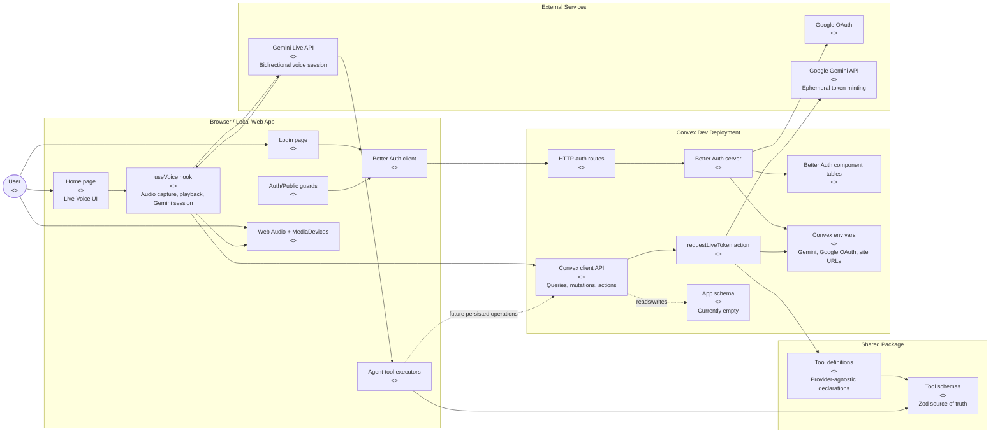

# Architecture Robustness Diagram

This diagram shows the main runtime responsibilities and collaborations in the local development setup.

## Notes

- The frontend runs locally through Vite and connects to Convex with `VITE_CONVEX_URL` and `VITE_CONVEX_SITE_URL`.
- Convex functions run in the dev deployment, not in the local Vite process.
- Auth HTTP routes are registered through the Better Auth Convex component.
- `requestLiveToken` validates the authenticated user, reads `GEMINI_API_KEY`, and returns a short-lived Gemini Live token to the browser.
- Voice tool schemas live in `packages/shared` so the backend can declare tools to Gemini and the frontend can validate/execute matching tool calls.

## What This Diagram Shows

The diagram is organized using a robustness-style split:

- `<<actor>>`: the user interacting with the app.
- `<<boundary>>`: surfaces where the system receives input or exposes behavior, such as the web UI, auth HTTP routes, browser audio APIs, and the Convex client API.
- `<<control>>`: orchestration logic that coordinates flows, such as route guards, the voice hook, the Better Auth server, and the `requestLiveToken` action.
- `<<entity>>`: state or domain contracts, such as env vars, auth component tables, app schema, and shared tool schemas.
- `<<service>>`: external systems outside this repository, such as Google OAuth, Gemini token minting, and Gemini Live.

The main flow is: the user opens the web app, authenticates through Better Auth routes hosted by Convex, then the `Home` page uses `useVoice` to request a short-lived Gemini Live token from Convex. Once connected, the browser streams microphone audio to Gemini Live and receives audio/text/tool-call responses. Tool calls are routed back into frontend executors that currently validate against the shared schemas and return mock finance data.

This is also showing an important boundary decision: the app is local only at the frontend layer. Backend functions, auth routes, auth storage, and secrets live in Convex Cloud, even during development.

## Architecture Opinion

The current distribution is reasonable for an early voice-first prototype. The strongest choice is the shared tool contract in `packages/shared`: it keeps Gemini declarations and frontend tool execution aligned, which matters a lot once tools start mutating real financial data.

The weakest area is that the finance domain is not represented yet. `schema.ts` is empty and frontend tool executors return mocked transactions/accounts, so the voice loop exists before the expense-tracking backend model. For this app, I would prioritize adding explicit backend tables and Convex mutations for accounts, transactions, categories, and maybe conversation/audit events. The frontend should not remain the place where finance tools are implemented once they affect real user data.

I would also move from "tool executor calls are local mocks" to "tool executor validates input and delegates to Convex mutations/actions." That keeps authorization, validation, and persistence in the backend, which is especially important for a personal finance product.
