# Backend Component Diagram

```mermaid
flowchart TB
    subgraph backend["packages/backend"]
        packageJson["package.json\nconvex dev/typecheck scripts"]
        convexConfigFile["convex.json\nConvex project config"]

        subgraph convexDir["convex/"]
            appConfig["convex.config.ts\nComponent registration"]
            authConfig["auth.config.ts\nConvex auth provider config"]
            http["http.ts\nHTTP router"]
            auth["auth.ts\nBetter Auth integration"]
            liveActions["live/actions.ts\nGemini Live token action"]
            schema["schema.ts\nApp database schema"]
            crons["crons.ts\nScheduled jobs"]
            generated["_generated/*\nConvex generated API/types"]
        end
    end

    subgraph components["Convex Components"]
        betterAuthComponent["@convex-dev/better-auth\nComponent tables + adapter"]
        workflowComponent["@convex-dev/workflow\nInstalled dependency"]
    end

    subgraph shared["packages/shared"]
        zodSchemas["tools/definitions.ts\nZod schemas"]
        toolDefs["tools/index.ts\nSerializable tool definitions"]
        toolHelpers["tools/helpers.ts\nZod -> ToolSchema adapter"]
    end

    subgraph env["Deployment Environment"]
        convexDeployment["CONVEX_DEPLOYMENT"]
        convexUrl["CONVEX_URL"]
        convexSiteUrl["CONVEX_SITE_URL"]
        betterSecret["BETTER_AUTH_SECRET"]
        googleClient["GOOGLE_CLIENT_ID / SECRET"]
        geminiKey["GEMINI_API_KEY"]
        siteUrl["SITE_URL"]
    end

    subgraph external["External Services"]
        googleOAuth["Google OAuth"]
        gemini["Google Gemini API"]
        convexCloud["Convex Cloud Runtime"]
    end

    packageJson --> convexConfigFile
    packageJson --> convexCloud
    convexConfigFile --> convexCloud

    appConfig --> betterAuthComponent
    http --> auth
    http --> betterAuthComponent
    auth --> authConfig
    auth --> betterAuthComponent
    auth --> googleOAuth
    auth --> convexSiteUrl
    auth --> googleClient
    auth --> siteUrl
    auth --> betterSecret

    liveActions --> generated
    liveActions --> toolDefs
    toolDefs --> zodSchemas
    toolDefs --> toolHelpers
    liveActions --> geminiKey
    liveActions --> gemini

    schema -. "currently no app tables" .-> convexCloud
    crons -. "no scheduled behavior shown" .-> convexCloud
    generated --> convexCloud
    betterAuthComponent --> convexCloud
    workflowComponent -. "available for future durable workflows" .-> convexCloud
```



## Current Backend Responsibilities

- `convex.config.ts` installs the Better Auth Convex component.
- `http.ts` registers Better Auth HTTP routes with CORS enabled.
- `auth.ts` configures Better Auth with the Convex adapter, Google OAuth, cross-domain support, and a `getCurrentUser` query.
- `live/actions.ts` exposes `requestLiveToken`, checks Convex auth, reads `GEMINI_API_KEY`, converts shared tool definitions to Gemini function declarations, and mints a short-lived Gemini Live token.
- `schema.ts` currently defines no application tables; persisted finance data is not modeled yet.
- `_generated/*` is Convex-generated and is consumed by the frontend through `@wallet-bot/backend/api`.

## What This Diagram Shows

This diagram focuses on the Convex backend package and how it connects to shared code, Convex components, environment variables, and external providers.

The backend currently has three important runtime areas:

- Auth: `convex.config.ts` installs the Better Auth component, `http.ts` exposes Better Auth HTTP routes, and `auth.ts` configures Google OAuth, cross-domain auth, the Convex adapter, and the `getCurrentUser` query.
- Live voice token generation: `live/actions.ts` is a Convex action that requires an authenticated identity, reads `GEMINI_API_KEY`, converts shared tool definitions into Gemini-compatible function declarations, and asks Google Gemini for a short-lived Live API token.
- Generated Convex API/types: `_generated/*` is what lets frontend code call backend functions with typed references through `@wallet-bot/backend/api`.

The diagram also calls out deployment env vars because they are part of the backend architecture in Convex. Secrets like `GEMINI_API_KEY` and `GOOGLE_CLIENT_SECRET` are not frontend configuration. They must live in the Convex deployment.

## Structure Opinion

The backend is appropriately small for the current implementation. Auth and live-token generation are separated, and the shared package is used in the right direction: backend consumes shared tool definitions instead of duplicating Gemini tool schemas locally.

The main structural gap is the missing finance domain. `schema.ts` is empty, so the product's core concepts are not modeled yet. Given this is a conversational expense tracker, I would introduce backend modules around domain capabilities before adding more UI:

```text
convex/accounts/
convex/transactions/
convex/categories/
convex/voice/
convex/users/
convex/schema/
```

The exact folder pattern should follow the repo's Convex conventions, but the key idea is that transaction/account operations should become backend queries and mutations. The voice agent should call those functions through tools instead of returning mock data in the browser.

I would also add an audit trail for tool-driven changes. In a finance app, when an AI agent adds or edits a transaction, it is useful to store what tool was called, with what arguments, what user approved or triggered it, and what mutation result was produced. That gives you debuggability and a path toward review/undo flows.

Finally, `@convex-dev/workflow` is installed but not used yet. I would not introduce workflows until there is a real multi-step backend process, such as receipt parsing, delayed categorization, bank sync, or recurring transaction detection. For simple CRUD, plain Convex queries and mutations are enough.
