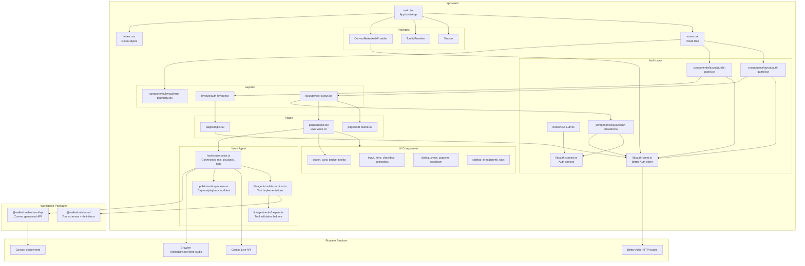

# Frontend Component Diagram



## Current Frontend Responsibilities

- `main.tsx` wires Convex, Better Auth, tooltips, routing, and global notifications.
- `router.tsx` separates public login routes from authenticated app routes.
- `home.tsx` is the current primary app screen and renders the voice controls/event log.
- `use-voice.ts` owns microphone capture, audio playback, Gemini Live connection, token request, and tool-call dispatch.
- `lib/agent-tools` maps Gemini function calls to local executors; current transaction/account behavior is mocked.
- `@wallet-bot/shared` is the frontend/backend contract for voice tool names and schemas.

## What This Diagram Shows

This diagram breaks the frontend into the main parts that are visible in `apps/web`:

- Bootstrap and routing: `main.tsx` creates the React app, wires providers, and mounts the router. `router.tsx` defines the split between public login routes and authenticated app routes.
- Auth layer: `auth-client.ts` configures Better Auth against the Convex site URL, while guards decide whether the user can access public or private routes.
- Layouts and pages: the current product surface is small. `/login` handles authentication and `/` renders the `Home` page with the live voice experience.
- Voice agent: `use-voice.ts` is the central frontend control module. It handles microphone permissions, device selection, audio worklets, Gemini Live connection lifecycle, token fetching through Convex, playback, logs, and function-call handling.
- UI components: reusable components live under `components/ui`, mostly following the shadcn-style component split.
- Workspace dependencies: the frontend imports the generated Convex API from `@wallet-bot/backend/api` and tool contracts from `@wallet-bot/shared`.

The most important dependency chain is `Home -> useVoice -> Convex action -> Gemini Live`. Auth is a separate chain through `authClient -> Better Auth HTTP routes`.

## Structure Opinion

For the current size, the frontend is understandable. The app has a clean separation between routing, auth, UI primitives, and the voice hook. The main concern is that `use-voice.ts` is doing a lot: audio capture, audio conversion, device management, session lifecycle, Gemini message handling, playback, logs, and tool-call dispatch all live in one file.

For a voice-first finance app, I would eventually split the voice feature into a feature folder, for example:

```text
src/features/voice/
  use-voice-session.ts
  audio-capture.ts
  audio-playback.ts
  gemini-live-client.ts
  voice-log.ts
  tool-dispatch.ts
```

That would make it easier to test and evolve the voice experience without turning one hook into the entire runtime.

I would also move `lib/agent-tools` closer to a domain boundary once real persistence exists. Right now the executors are frontend mocks, which is fine for proving the Gemini loop. For real expenses, these tools should call backend Convex mutations so the backend owns authorization, validation, idempotency, and writes.

The UI structure is fine, but as the app grows beyond the voice console, I would avoid putting all screens directly under `pages/` with shared state scattered across hooks. A feature-first split like `features/transactions`, `features/accounts`, `features/voice`, and `features/auth` would fit this product better once transaction history, account management, and analytics screens appear.
